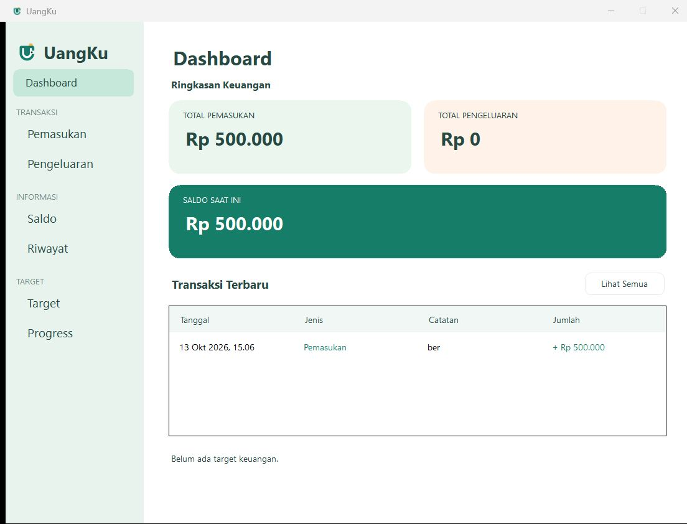
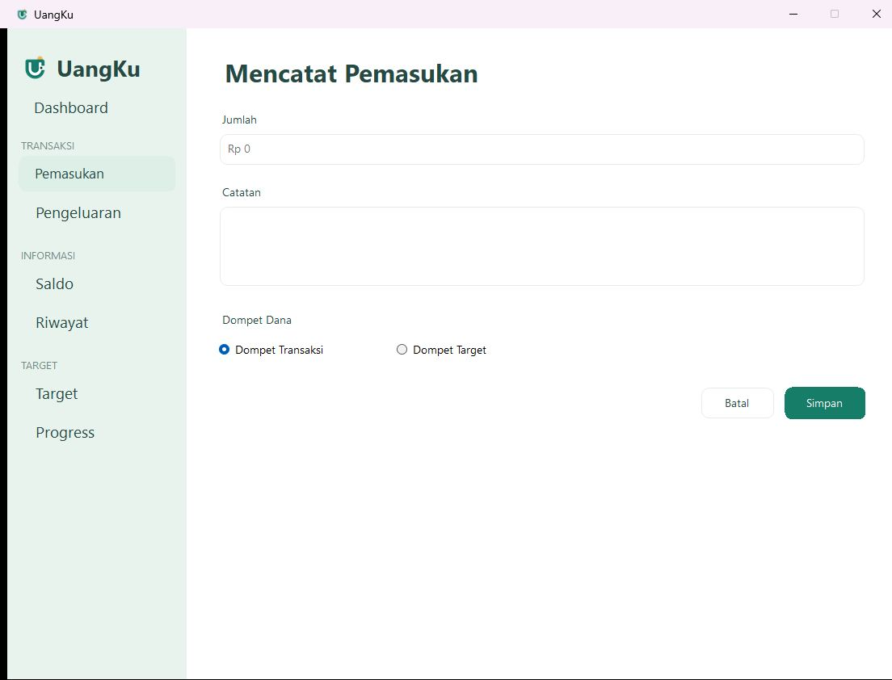
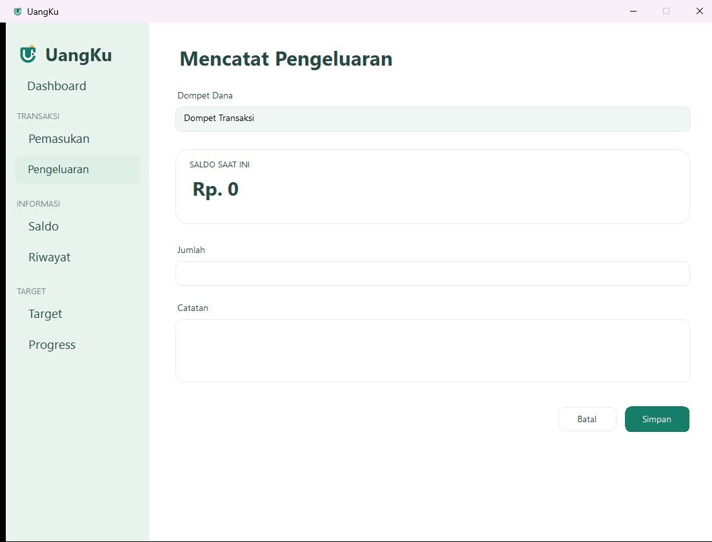
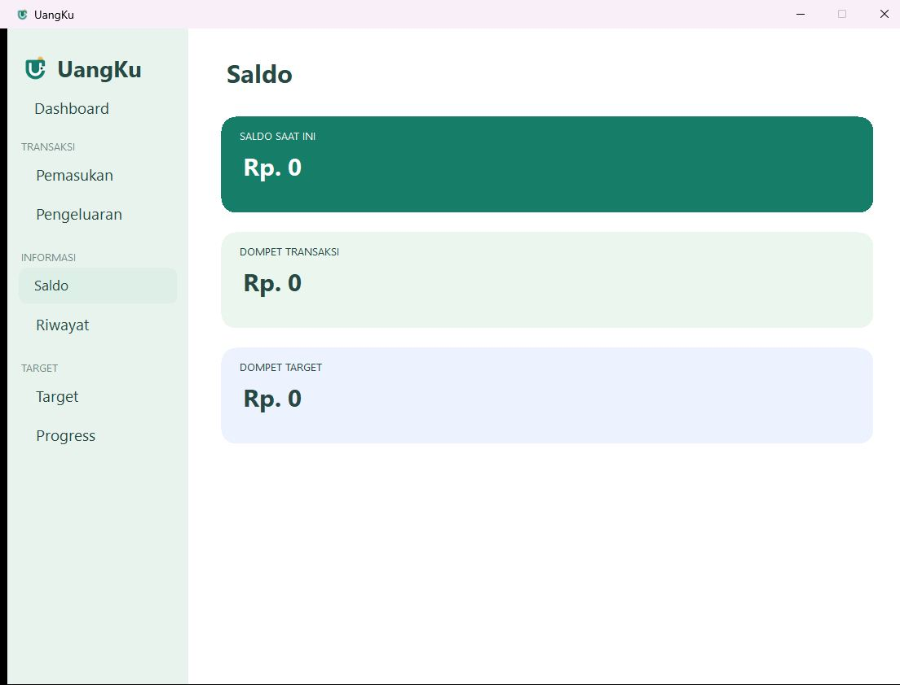
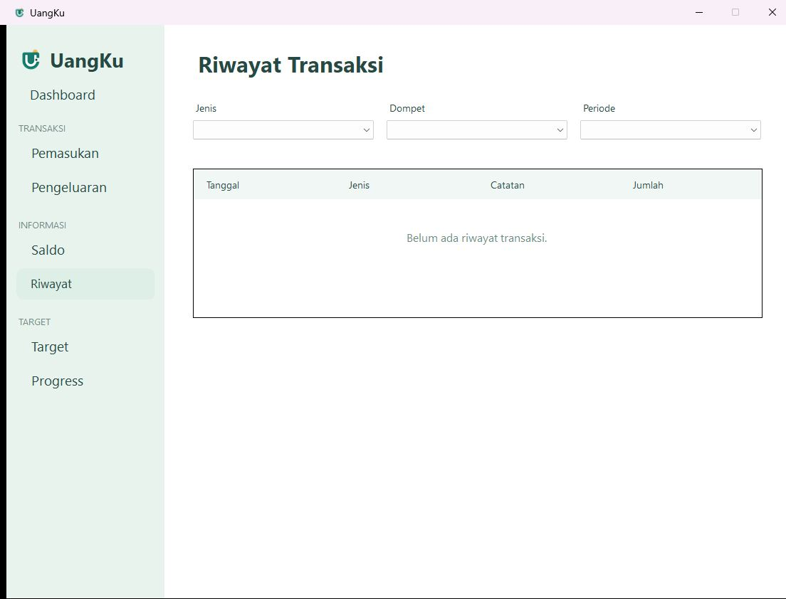
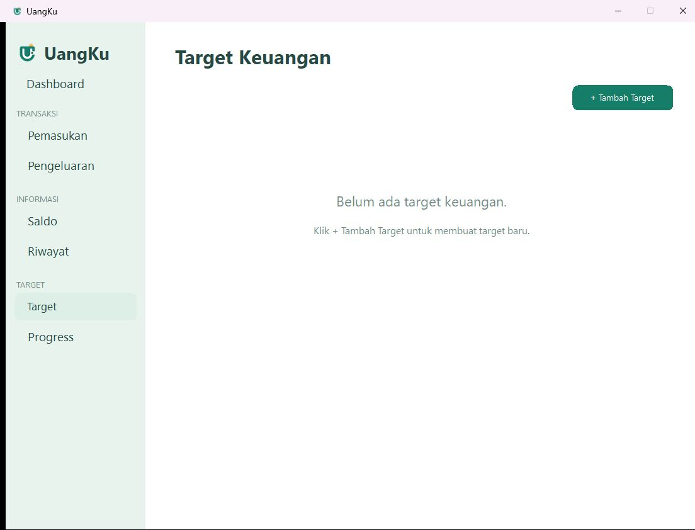
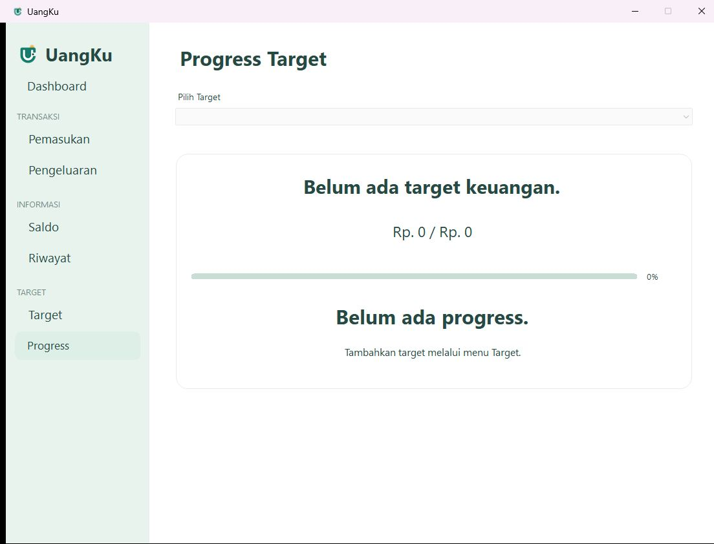

# UangKu

**UangKu** adalah aplikasi desktop manajemen keuangan pribadi berbasis **C# (.NET 10 Windows Forms)** dan **PostgreSQL** untuk mencatat pemasukan, pengeluaran, memantau saldo dompet, serta mengelola target tabungan.

---

## Fitur Utama

- **Dashboard** — Menampilkan ringkasan **Total Pemasukan**, **Total Pengeluaran**, **Saldo Saat Ini**, daftar transaksi terbaru, dan status target keuangan utama.
- **Pemasukan & Pengeluaran** — Mencatat transaksi pemasukan ke **Dompet Transaksi** atau langsung ke **Dompet Target**, serta mencatat pengeluaran dari **Dompet Transaksi** dengan validasi saldo.
- **Saldo** — Menampilkan rincian **Saldo Saat Ini**, saldo **Dompet Transaksi**, dan saldo **Dompet Target**.
- **Riwayat Transaksi** — Menampilkan histori transaksi dengan filter berdasarkan **Jenis** (*Semua Jenis*, *Pemasukan*, *Pengeluaran*), **Dompet** (*Semua Dompet*, *Dompet Transaksi*, *Dompet Target*), dan **Periode** (*Semua*, *Minggu*, *Bulan*, *Tahun*).
- **Target Keuangan & Progress** — Membuat dan mengubah target tabungan, melakukan setoran dari Dompet Transaksi maupun penarikan tabungan target, serta memantau persentase pencapaian pada halaman **Progress**.

---

## Teknologi yang Digunakan

- **Framework**: .NET 10 (`net10.0-windows`) — Windows Forms
- **Database**: PostgreSQL
- **ORM & Driver**: `Npgsql` `10.0.3` & `Npgsql.EntityFrameworkCore.PostgreSQL` `10.0.3`
- **Konfigurasi Environment**: `dotenv.net` `4.2.0`

---

## Prasyarat & Cara Menjalankan

1. **Prasyarat**
   - Windows dengan [.NET 10 SDK](https://dotnet.microsoft.com/download)
   - [PostgreSQL](https://www.postgresql.org/) yang sedang berjalan

2. **Konfigurasi Environment (`.env`)**
   Salin file `.env.example` menjadi `.env`, lalu sesuaikan kredensial PostgreSQL Anda:

   ```env
   DB_HOST=localhost
   DB_PORT=5432
   DB_NAME=postgres
   DB_USER=postgres
   DB_PASSWORD=uangku
   ```

   *(Atau gunakan `DB_CONNECTION_STRING` secara langsung jika diperlukan.)*

3. **Jalankan Aplikasi**

   ```powershell
   dotnet restore
   dotnet run
   ```

   Saat pertama kali dijalankan, aplikasi akan otomatis menginisialisasi skema database (`wallet`, `target`, `transactions`) serta membuat dompet bawaan (**Dompet Transaksi** dan **Dompet Target**).

---

## Struktur Proyek

```text
UangKu/
├── Assets/        # Ikon dan logo aplikasi
├── Controls/      # UserControl untuk setiap halaman (Dashboard, Pemasukan, Pengeluaran, Saldo, Riwayat, Target, Progress)
├── Data/          # Konfigurasi koneksi PostgreSQL dan AppDbContext (EF Core)
├── Forms/         # MainForm (navigasi sidebar dan host halaman)
├── Models/        # Entitas data (Wallet, Target, Transactions, TransactionsRecord, Enums)
├── Services/      # Logika bisnis & transaksi database
├── Themes/        # Pengaturan tema UI dan format mata uang
├── docs/          # Dokumentasi & screenshot aplikasi
├── Program.cs     # Entry point aplikasi
└── .env.example   # Contoh konfigurasi environment database
```

---

## Screenshot Aplikasi

### Dashboard


### Pemasukan


### Pengeluaran


### Saldo


### Riwayat Transaksi


### Target Keuangan


### Progress Target

